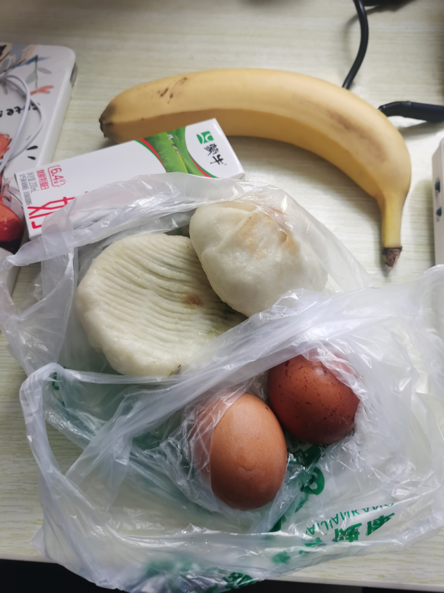
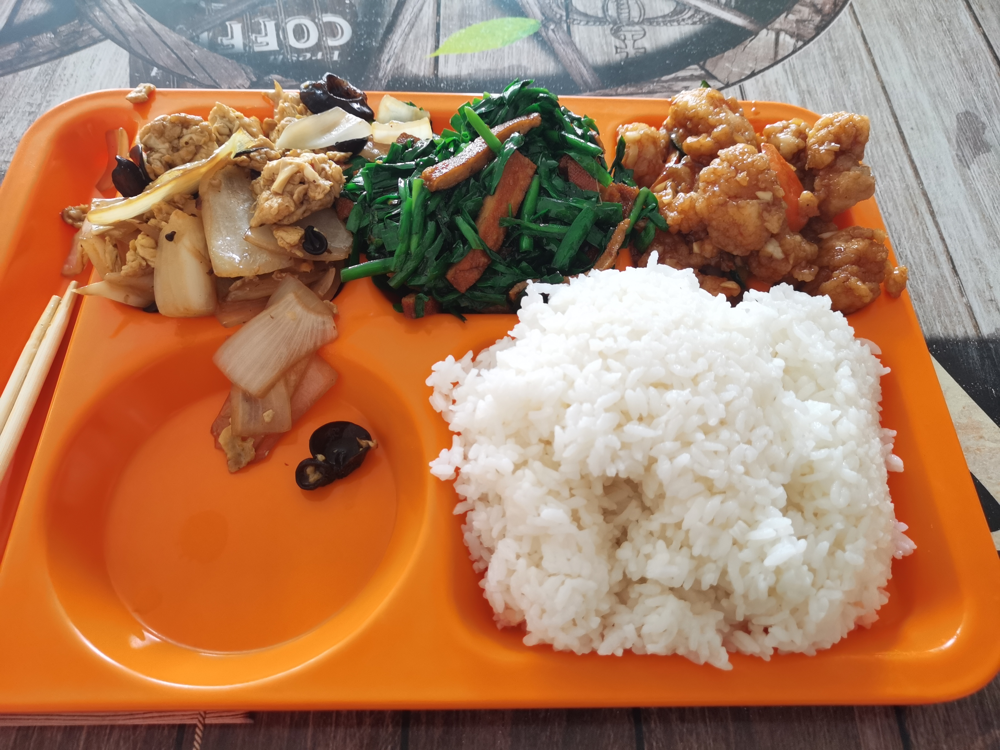
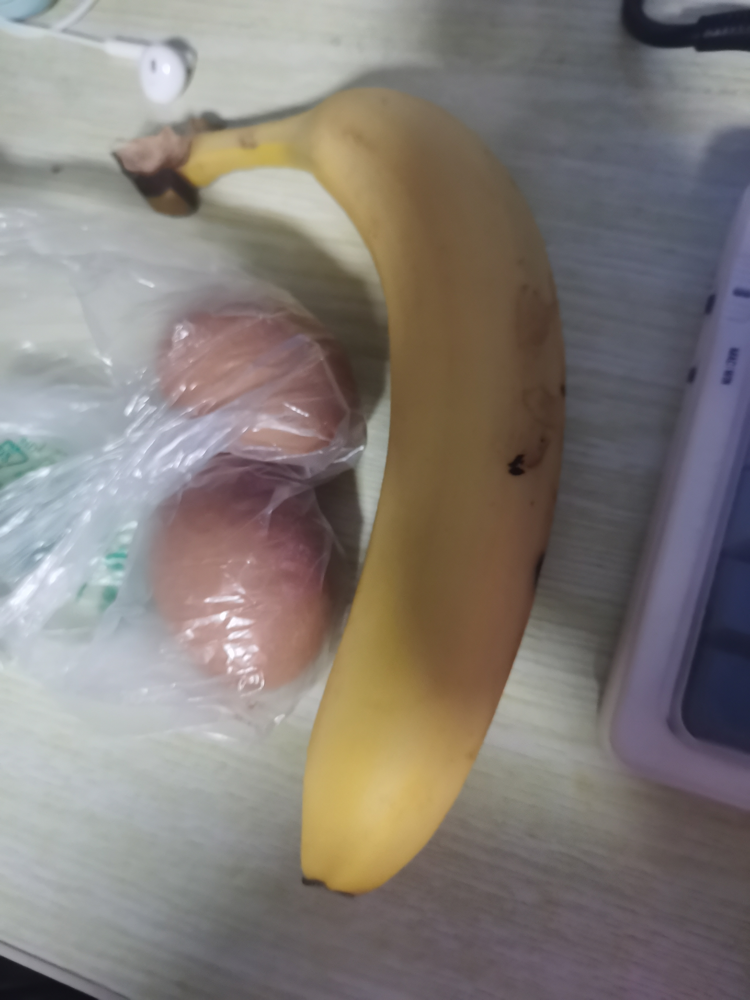

# 2026-10-11 薄肌营养日记

## 📅 日期与活动
- **日期**：2026年10月11日（周日，放假）
- **所在城市**：北京昌平
- **当日活动**：休息日，商场购物（迪卡侬），步数 15000
- **饮水**：约 2000 ml（达标）
- **作息**：休假自由模式

## 🍽 餐次记录与蛋白质分布
### **第一顿 / 早餐（09:40）**

- 水煮蛋 2个
- 包子 2个（韭菜鸡蛋、奥尔良鸡肉）
- 蒙牛纯牛奶 250ml
- 香蕉 1根
- **蛋白质**：约 35–40 g

### 第二顿 / 午餐（16:20）**

- 大米饭 约 250–300 g
- 白洋葱炒木耳鸡蛋 约 150 g
- 韭菜炒豆干 约 150 g
- 熘肉段 约 100–120 g
- **蛋白质**：约 30–35 g
- **备注**：高油、高钠、高碳水。熘肉段挂糊油炸是主要脂肪来源。

### 第三顿 / 加餐（18:20）**

- 水煮蛋 2个
- 香蕉 1根
- **蛋白质**：约 13–15 g
- **备注**：极简低脂，无额外油脂与钠，高钾。

## 📊 全天营养总览

| 营养素   | 估算摄入量     | 目标区间           | 达标情况                |
| :------- | :------------- | :----------------- | :---------------------- |
| 热量     | 2150–2300 kcal | 2100–2200 kcal     | ✅ 基本达标              |
| 蛋白质   | 85–95 g        | 110–125 g          | ❌ 未达标（缺口 25–30g） |
| 脂肪     | 85–100 g       | 47–62 g            | ❌ 严重超标              |
| 碳水     | 230–250 g      | 200–230 g (休息日) | ⚠️ 略超标                |
| 膳食纤维 | 12–15 g        | 25–30 g            | ❌ 不足                  |
| 钠       | 3000–3500 mg   | < 2000 mg          | ❌ 严重超标              |
| 钾       | 约 1800 mg     | 3500 mg            | ⚠️ 不足                  |
| 饮水     | 2000 ml        | 2000–3000 ml       | ✅ 达标                  |

## 🥩 蛋白质专项追踪
- **摄入总量**：85–95 g
- **目标区间**：110–125 g
- **达标情况**：未达标
- **各餐分布**：早餐（约40g） / 午餐（约35g） / 晚餐（约15g）
- **次日早餐补充建议**：增加 2 个水煮蛋 + 1 盒纯牛奶，或将主食替换为即食鸡胸肉/豆腐干。必须避免早餐碳水过高（如包子+香蕉组合）。

## ⭐ 评分与建议
- **当日综合评分**：**6.5 / 10**
- **优点**：饮水达标；第三顿极简低脂（水煮蛋+香蕉）表现出色；15000步活动量对代谢和尿酸排泄十分有利。防守成功，没有在晚上暴饮暴食。
- **不足**：全天脂肪和钠严重超标（熘肉段是最大雷区）；蛋白质缺口明显；绿叶蔬菜摄入不足。
- **改进建议**：
  1. **明天早餐必须降碳水、提蛋白**：2个水煮蛋 + 1盒纯牛奶 + 半根玉米/一个小包子。
  2. **明天午晚餐策略**：点快餐时优先选“番茄炒蛋”、“炖豆腐”、“清炒时蔬”，如果吃肉，**坚决用热水涮掉表面油盐，不拌菜汁**。
  3. **饮水延续**：明天继续喝够 2000–2500 ml 白开水。

## 📝 备注
- 痛风恢复期：左脚大脚趾无痛感，今日未出现异常。但午餐的高脂食物已造成代谢压力，需连续3天严格控钠控油。
- 睡眠：目标 23:00 前入睡，保证 7–8 小时睡眠，避免熬夜诱发代谢紊乱。