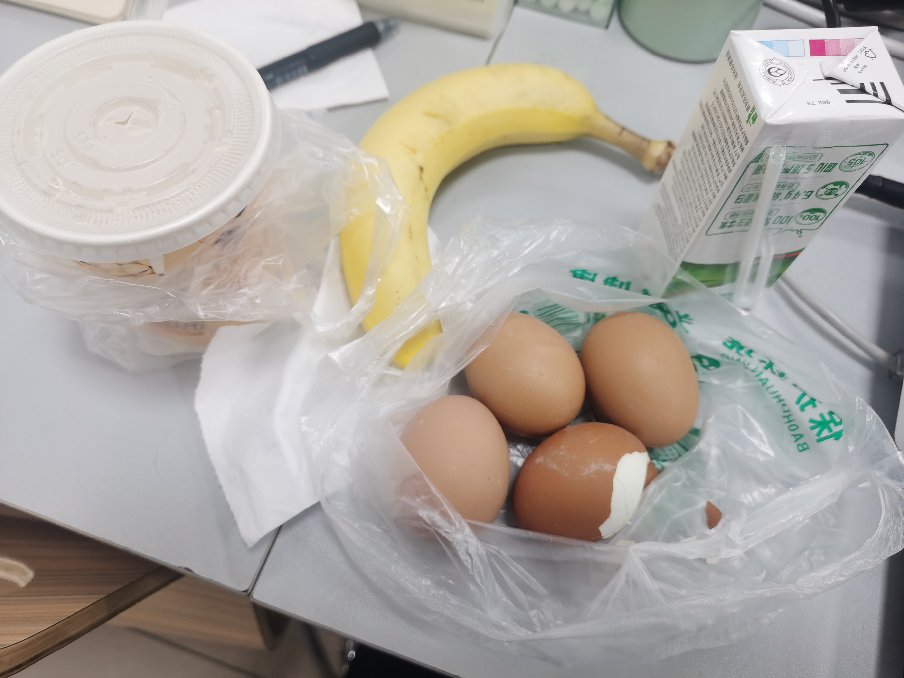
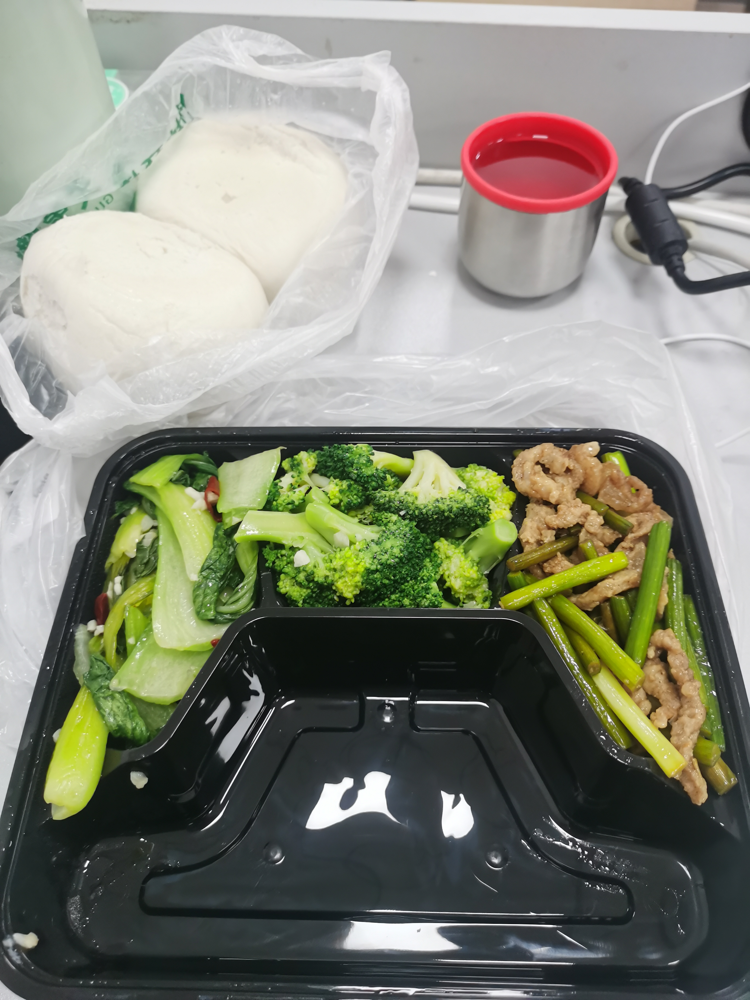
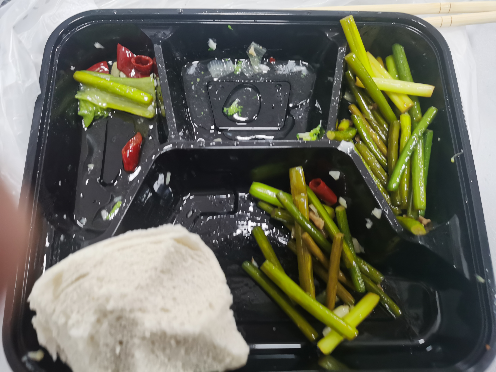
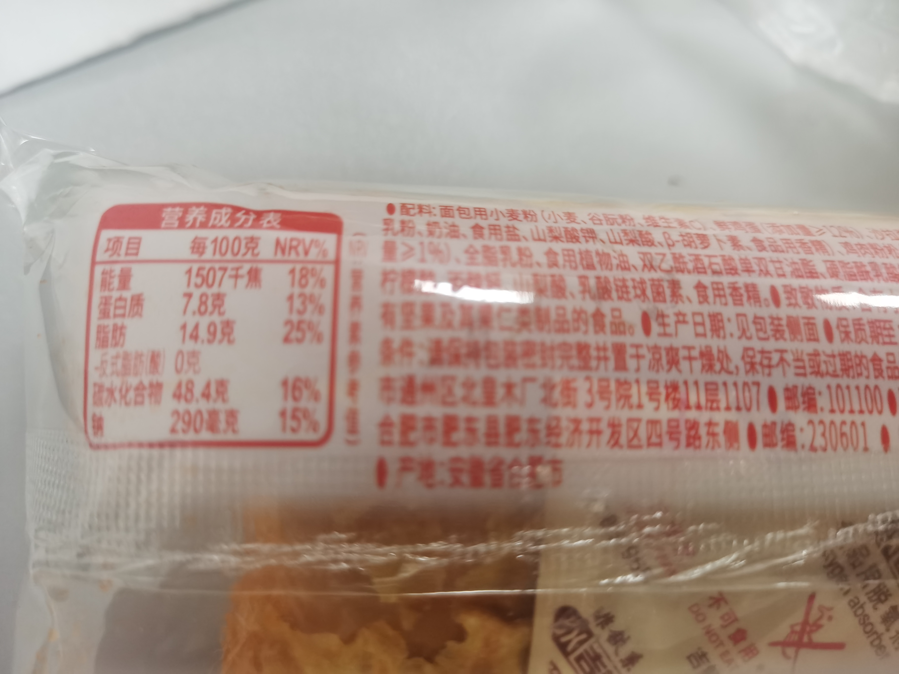
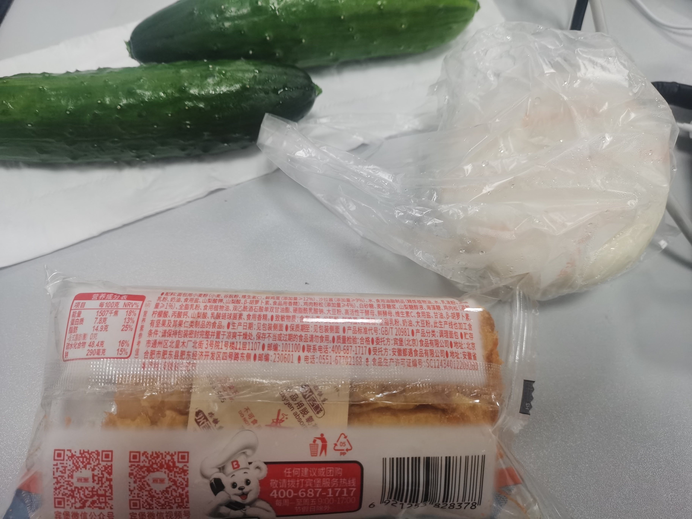
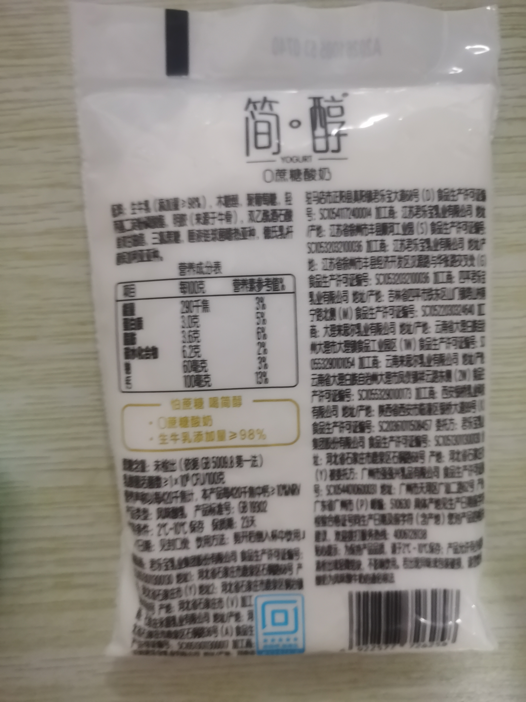
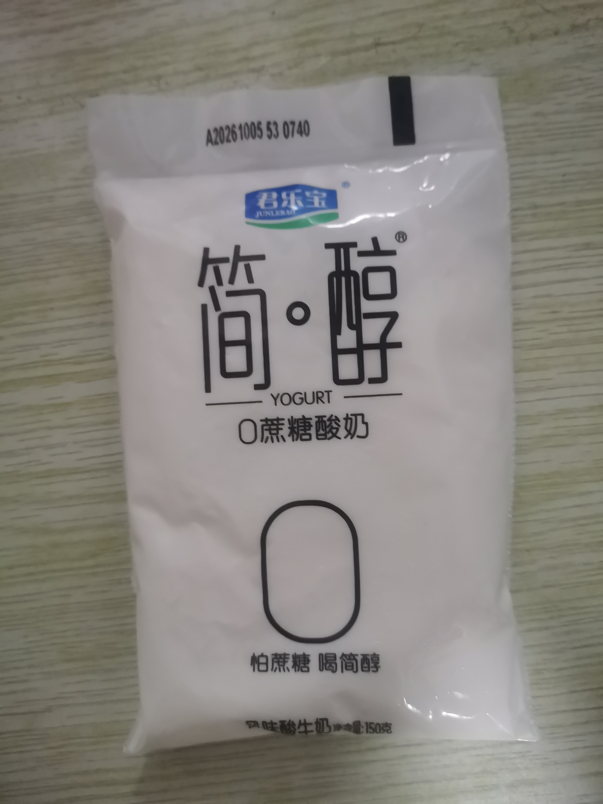

# 2026-10-12 薄肌营养日记

## 📅 日期与活动
- **日期**：2026年10月12日（周一，培训日）
- **所在城市**：北京昌平
- **当日活动**：培训日全天课程，步数 9600步
- **饮水**：约 2800 ml（完美达标，对排钠降尿酸极好！）
- **补剂/装备**：即食鸡胸肉未到货（物流延迟），今日蛋白质全靠鸡蛋、牛奶、酸奶及快餐支撑。

## 🍽 餐次记录与蛋白质分布

**第一顿 / 早餐（07:55）**
- 4个蛋清 + 2个蛋黄
- 无糖豆浆 250ml
- 纯牛奶 200ml
- 香蕉 1根
- **蛋白质**：约 34 g
- **评价**：完美开局，低钠高蛋白。

**第二顿 / 午餐（12:00）**
- 馒头 1.5个
- 蒜苔炒肉（只吃了瘦肉，未吃蒜苔）
- 西兰花、炒油菜
- **蛋白质**：约 24 g
- **⚠️ 关键变量**：即食鸡胸肉未到货，导致计划中的20g蛋白质缺位。

**第三顿 / 加餐（17:30）**
- 黄瓜 2根
- 宾堡面包 1个（约80g）
- 奥尔良包子 1个
- **蛋白质**：约 16 g
- **⚠️ 计划外食物**：因午餐蛋白质不足产生饥饿，额外摄入了碳水、脂肪和钠。

**第四顿 / 晚餐（22:00）**
- 君乐宝简醇0蔗糖酸奶 1袋（150g）
- **蛋白质**：约 4.5 g
- **⚠️ 遗漏**：原计划的2个蛋清未吃。

## 📊 全天营养总览
| 营养素 | 估算摄入量 | 目标区间 | 达标情况 |
| :--- | :--- | :--- | :--- |
| 热量 | 1600–1700 kcal | 2100–2200 kcal | ❌ 严重偏低 |
| 蛋白质 | 78.5 g | 110–125 g | ❌ 严重缺口（差31.5–46.5g） |
| 脂肪 | 约 45 g | 47–62 g | ✅ 基本达标 |
| 碳水 | 约 200 g | 200–230 g (培训日) | ✅ 基本达标 |
| 膳食纤维 | 约 8 g | 25–30 g | ❌ 严重不足（蒜苔没吃，黄瓜纤维极低） |
| 钠 | 约 2500 mg | < 2000 mg | ❌ 超标（奥尔良包子+快餐） |
| 饮水 | 2800 ml | 2500–3000 ml | ✅ 完美达标 |

## 🥩 蛋白质专项追踪
- **摄入总量**：78.5 g
- **目标区间**：110–125 g
- **达标情况**：严重未达标（缺口 31.5–46.5g）
- **各餐分布**：早餐（34g）/ 午餐（24g）/ 加餐（16g）/ 晚餐（4.5g）
- **鸡胸肉到货前补救**：必须在早餐或午餐通过便利店“卤蛋（1.5元/个）”或“无糖纯牛奶”或“原味豆干”顶替鸡胸肉的蛋白质。

## ⭐ 评分与建议
- **当日综合评分**：**6.5 / 10**（因饮水达标，上调0.5分）
- **优点**：早餐执行完美；午餐主食控制好（1.5个馒头）；饮水2.8L非常自律，排钠效果好。
- **不足**：膳食纤维极度缺乏（不吃蒜苔是个大损失）；下午的宾堡面包（脂肪高达14.9g/100g）和奥尔良包子踩了减脂和控钠的红线。
- **明天强制改进项**：
  1. **午餐12:00定闹钟**：鸡胸肉没到之前，务必在快餐里加一个卤蛋，或吃完去便利店买一盒纯牛奶。
  2. **吃菜策略**：蒜苔如果不爱吃，换成芹菜、豆角等纤维高的菜，**必须吃完蔬菜**，解决便秘和尿酸排泄问题。
  3. **加餐兜底**：鸡胸肉到货前，下午加餐只吃“黄瓜+纯牛奶/茶叶蛋”，**严禁买面包和奥尔良包子**。

## 📝 备注
- 痛风恢复期：左脚大脚趾今日无异常。
- 睡眠：22:00结束进食，预计23:00前入睡，保证8小时睡眠。